# Activité Pratique N°1 : Implémentation d'un micro-service

Ce projet s'inscrit dans le cadre du cours de **Systèmes Distribués et Architectures Agentiques**. Il illustre la mise en œuvre pratique d'une architecture orientée micro-services.

---

## 📋 Table des matières
* À propos du projet
* Architecture générale
* Prérequis
* Structure du projet
* Screenshots


---

## 🚀 À propos du projet

Cette première activité pratique a pour objectif de concevoir, développer et déployer un premier **micro-service** indépendant. Elle permet de manipuler les concepts fondamentaux de la modularité, de l'exposition d'API REST et de la persistance des données au sein d'un environnement distribué.

---

## 🏛️ Architecture générale

* **Style architectural** : Orienté micro-services
* **Communication** : API REST / HTTP
* **Modèle de données / Persistance** : Spring Data JPA / H2

---

## ⚙️ Prérequis

Avant de lancer le projet, assurez-vous d'avoir installé sur votre machine :
* **Java** (JDK 17 ou version supérieure recommandée)
* **Maven** (ou utilisation du wrapper `./mvnw`)
* **Git**
* Un client API (comme **Postman**, **Insomnia** ou `curl`) pour tester les endpoints REST.

---

## 📁 Structure du projet

```text
Activité Pratique N°1 - Implémentation d'un micro-service/
├── src/
│   ├── main/
│   │   ├── java/com/...    # Code source (Entités, Repositories, Services, Contrôleurs)
│   │   └── resources/      # Fichiers de configuration (application.properties / application.yml)
   └── test/               # Tests unitaires et d'intégration
├── pom.xml                 # Configuration Maven / Dépendances
└── README.md
```

---

## Screenshots
### Swagger
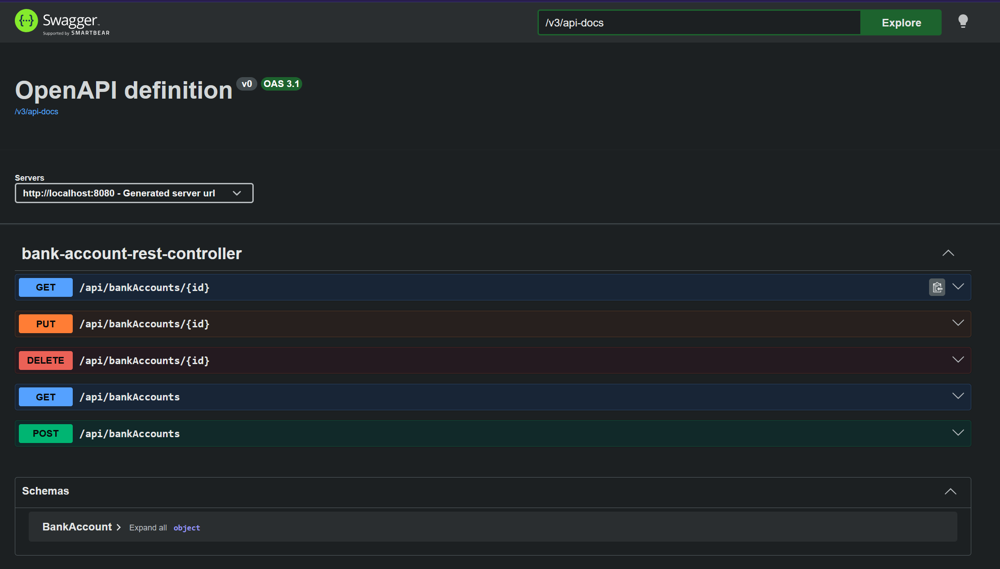
#### Display all accounts
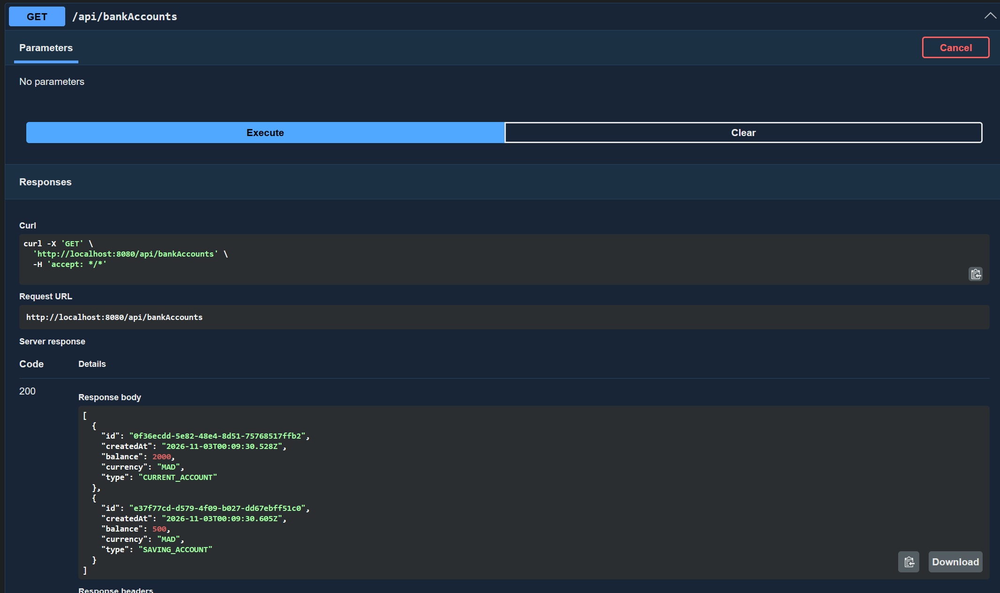
#### Display account by ID
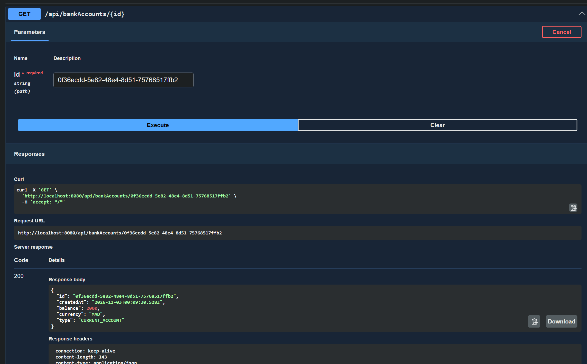
#### Create account
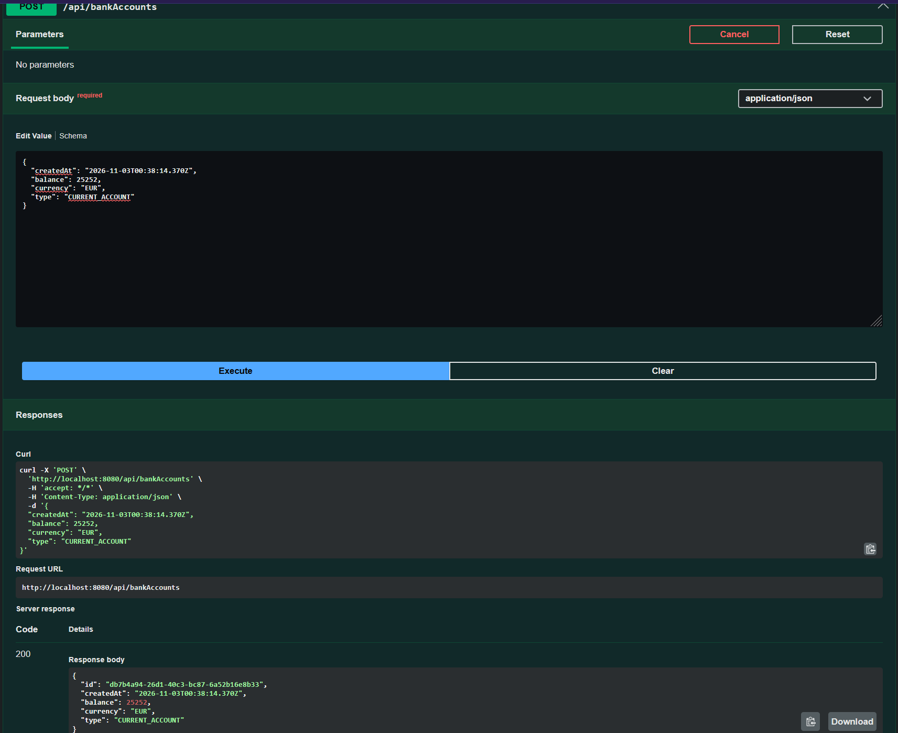
#### Update account
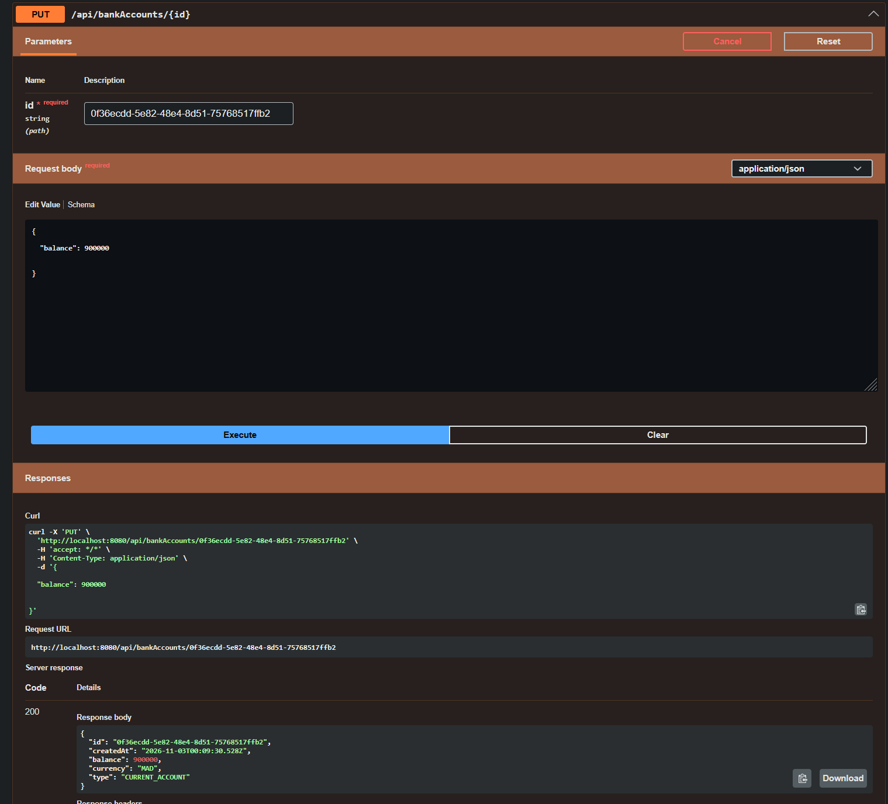
#### Delete account
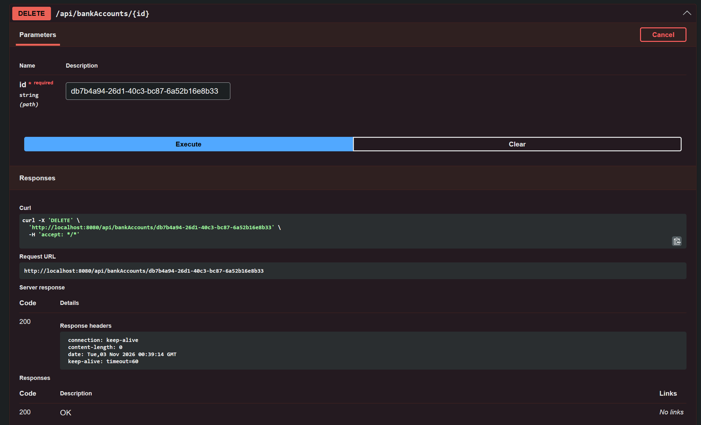

### Postman
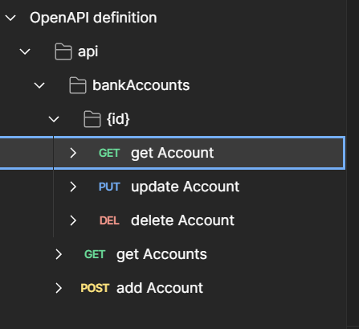
#### Display all accounts
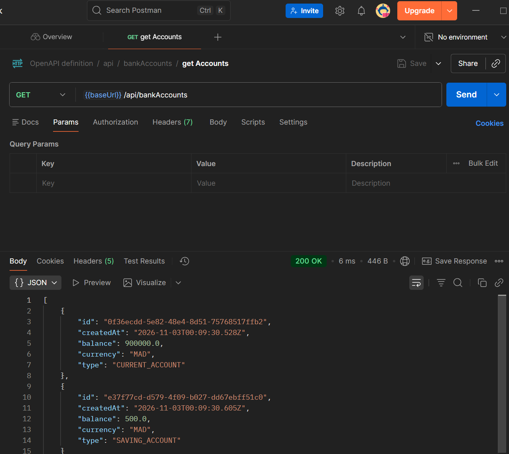
#### Display account by ID
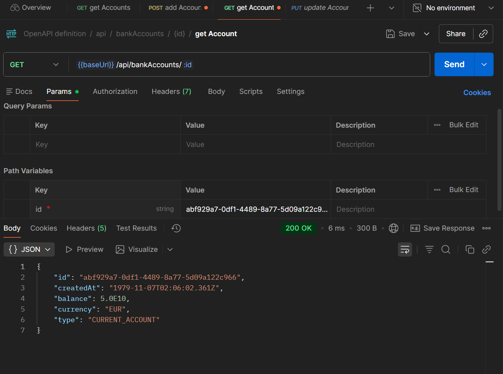
#### Create account
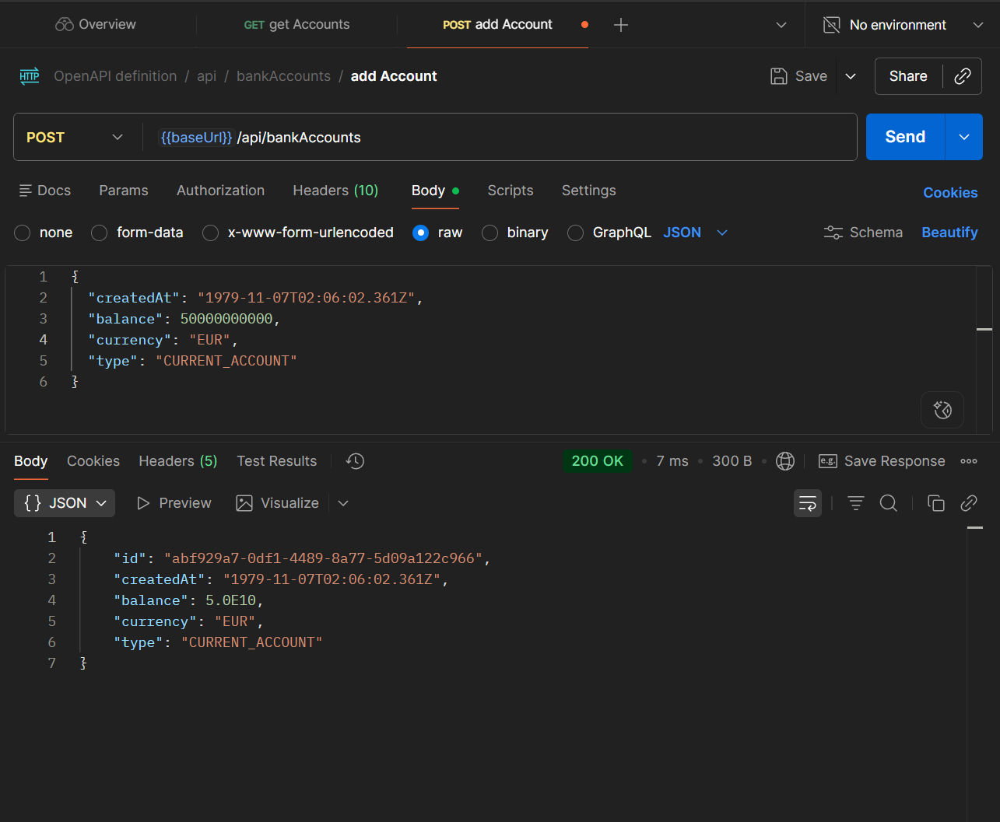
#### Update account
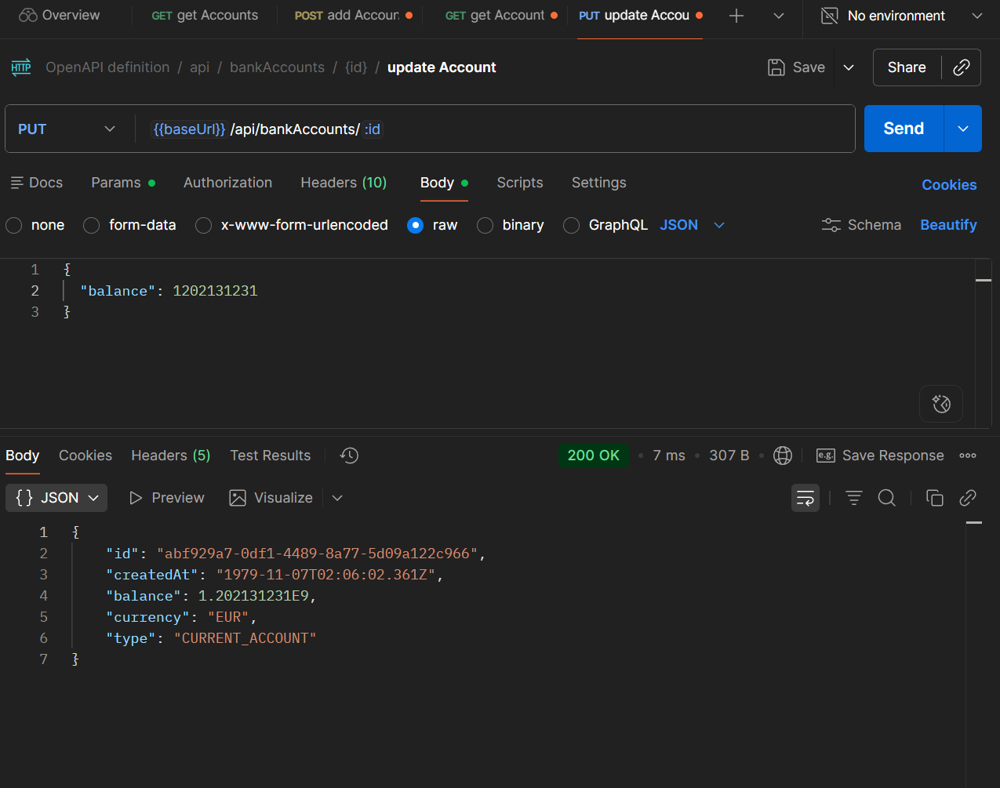
#### Delete account
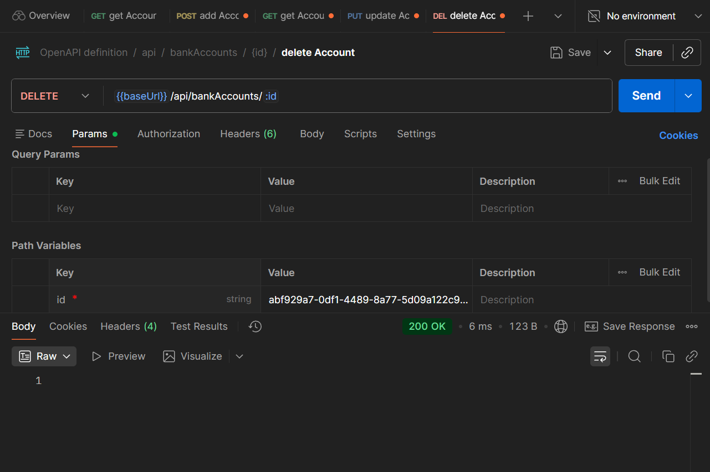

### Spring data rest
#### Display all accounts

#### Display account by ID

### Projection

### Display account by Type


### graphql
#### Display all accounts
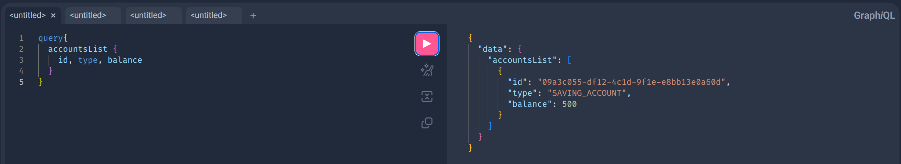
#### Create account
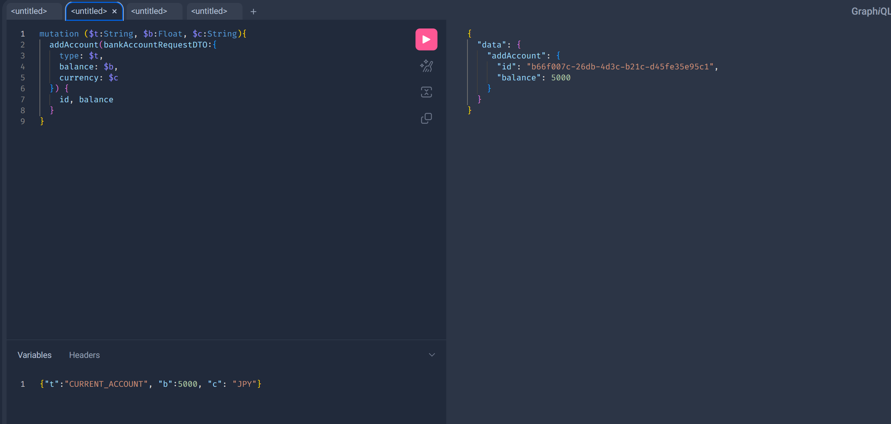
#### Update account
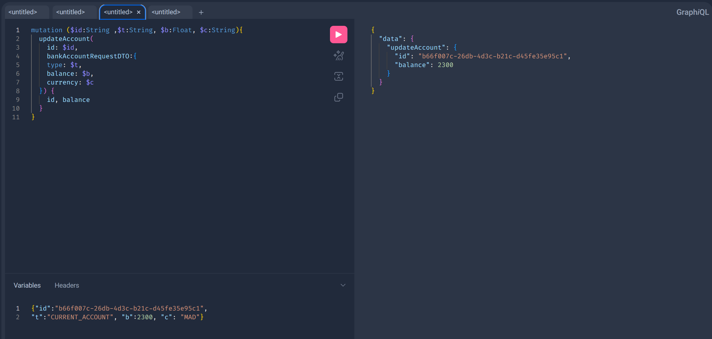
#### Delete account
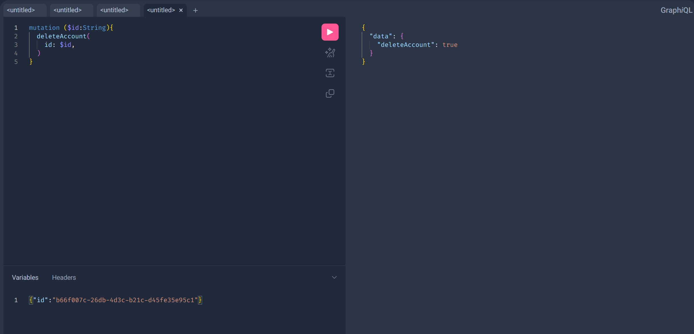